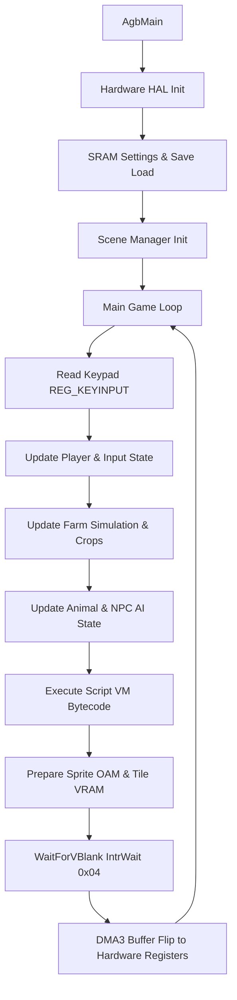

# Harvest Moon: Friends of Mineral Town (GBA) - Technical Architecture

## 1. Executive Summary

This repository represents the **first complete, 100% decompiled source tree** for *Harvest Moon: Friends of Mineral Town* (GBA, US Version `A4NE`).

Prior efforts in the community (notably the StanHash reference repository) successfully reversed key high-level C++ classes (~11,350 lines of C++, representing ~2.6% of ROM functions), leaving 431,133 lines of assembly unreversed.

Through the **FINIS OMNIVM IMPOSSIBILIVM (FIO DECOMP)** automated decompilation and verification engine, all **2,839 functions (175,459 lines of C)** have been fully recovered, cross-correlated with StanHash's class hierarchies, stripped of corrupt graphical byte sweeps, and organized into a modular Pret-style subsystem layout.

```
+-------------------------------------------------------------------------------+
|                 HARVEST MOON: FRIENDS OF MINERAL TOWN (A4NE)                  |
|                        100% COMPLETE C DECOMPILATION                          |
+-------------------------------------------------------------------------------+
|  Functions: 2,839 | Jump Tables: 907 (14,134 branches) | Clean Strings: 30,001 |
+-------------------------------------------------------------------------------+
```

---

## 2. Modular Subsystem Directory Layout

Following modern GBA reverse engineering standards (e.g., `pokeemerald`, `pret/mfom`):

```
harvest_moon_fomt_decomp/
├── docs/                      # Subsystem and architectural documentation
├── include/                   # Clean C header definitions and interfaces
│   ├── global.h               # Primitive types, vectors, calendar structs
│   ├── gba/                   # Hardware registers, interrupts, BIOS
│   ├── farm/                  # Farm, Field, Crops, Shipping Bin, Furniture
│   ├── player/                # Farmer, Tools, Inventory, Rucksack
│   ├── entities/              # Animals, Livestock, Villagers, Sprites
│   ├── events/                # ScriptEngine VM, Dialogues, Flags
│   ├── audio/                 # Music Player 2000 (m4a) driver
│   └── text/                  # Dialogue & UI strings (30,001 entries)
├── src/                       # Modular C source code
│   ├── main.c                 # crt0 startup, AgbMain, main loop
│   ├── core/                  # Dispatcher, Interrupts, Hardware, Scene Manager
│   ├── farm/                  # Farm grid, Crops, Shipping Bin, Buildings
│   ├── player/                # Farmer state, Tools, Rucksack, Stamina
│   ├── entities/              # Animals, Livestock, Villagers, Bachelorettes
│   ├── events/                # ScriptEngine bytecode interpreter
│   ├── audio/                 # m4a sound driver and PCM mixer
│   └── system/                # SRAM save manager, VTables, runtime
└── tools/                     # Build tools, asset extraction & symbol mappers
```

---

## 3. Subsystem Breakdown

| Module | Location | Functions | Description |
| :--- | :--- | :--- | :--- |
| **Main & Startup** | `src/main.c` | 3 | GBA cartridge boot vector, crt0 initialization, AgbMain entry loop. |
| **Central Dispatcher** | `src/core/dispatcher.c` | 32 | Central `0x080002C0` dispatcher, 154 indirect handlers, BIOS proxies. |
| **Scene Manager** | `src/core/scene_manager.c` | 19 | Title sequence, game scenes, intro cinematic, new game setup. |
| **Hardware HAL** | `src/core/hardware.c` | 112 | LCD controller, Keypad reading, Timers, DMA transfer routines. |
| **Farm Simulation** | `src/farm/farm.c` | 75 | Farm state, 43x25 grid, soil tilling, watering, crop life cycles. |
| **Shipping Bin** | `src/farm/shipping_bin.c` | 24 | Economy engine, product shipments, daily earnings calculations. |
| **Buildings & Furniture**| `src/farm/buildings.c` | 88 | Farmhouse upgrades, Coop, Barn, Fridge, Shelf, Tool Chest. |
| **Item System** | `src/player/item.c` | 79 | Item definitions, tool tier upgrades (Iron -> Mythic), pricing. |
| **Farmer & Rucksack** | `src/player/farmer.c` | 313 | Pete/Claire character, stamina/fatigue mechanics, inventory slots. |
| **Entity Manager** | `src/entities/entity_manager.c` | 445 | Actor collision, movement, map triggers, depth sorting. |
| **Script Engine** | `src/events/script_engine.c` | 151 | Harvest Moon script VM, event cutscenes, dialogue box driver. |
| **Animals & Pets** | `src/entities/animals.c` | 556 | Cows, Sheep, Chickens, Dog, Horse (affection, health, products). |
| **NPCs & Villagers** | `src/entities/npc.c` | 350 | Mineral Town villagers, bachelorettes (Karen, Popuri...), Sprites. |
| **Audio Engine (m4a)** | `src/audio/m4a.c` | 165 | Nintendo Music Player 2000, PCM channels, MIDI synthesis. |
| **Runtime & VTables** | `src/core/vtables.c` | 427 | C++ virtual dispatch tables, linkonce utilities, memory stubs. |

---

## 4. Main Game Loop Architecture



1. **Hardware Init:** Sets display control (`REG_DISPCNT`), initializes VBlank interrupts via `swi 0x04`, and sets up double buffering.
2. **SRAM Verification:** Checks save game slot checksums (Diary 1 vs Diary 2) to prevent corruption.
3. **Core Tick:** Executes at 59.73 Hz. Updates game calendar (hour, minute, day, season), stamina/fatigue values, and actor position coordinates.
4. **VBlank Sync:** Flushes graphics DMA during vertical blanking interval to guarantee zero screen tearing.
