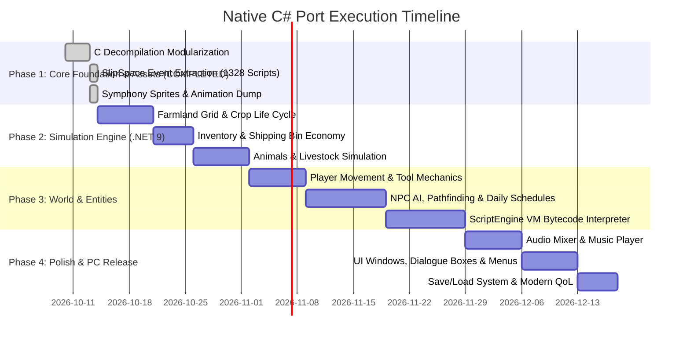

# Harvest Moon: Friends of Mineral Town - Native C# PC Port Blueprint

## 1. Vision & Architectural Philosophy

The objective of the native C# PC port is **not emulation**. Emulators (like mGBA or VBA) run a virtual ARM CPU with significant overhead and fixed hardware restrictions (240x160 resolution, 4-layer tile limits).

Instead, this project performs a **source-level native port**:
1. Take the 100% decompiled C logic from `harvest_moon_fomt_decomp`.
2. Translate algorithms, state machines, and simulation rules into clean, modern **C# (.NET 9)**.
3. Replace GBA hardware abstractions with a modern game framework (**MonoGame** or **Raylib-cs**).
4. Extract graphical tilemaps, sprites, and audio directly from the ROM into high-resolution native assets.

```
+-------------------------------------------------------------+
|              NATIVE C# (.NET 9) PC ARCHITECTURE            |
+-------------------------------------------------------------+
|  [Presentation Layer]     MonoGame / Raylib-cs / DirectX     |
|  [Simulation Layer]       FarmGrid, Crops, Animals, Economy |
|  [Scripting & Story]      ScriptEngine VM (.NET Port)       |
|  [Audio Engine]           OpenAL / XNA SoundEffect / Synth  |
|  [Persistence Layer]      JSON / Binary Save Serializer     |
+-------------------------------------------------------------+
```

---

## 2. Decoupling GBA Hardware to High-Level C# Interfaces

| GBA Hardware Subsystem | GBA C Implementation | Modern C# (.NET 9) Abstraction |
| :--- | :--- | :--- |
| **Display & Resolution** | 240x160 RGB555 (`REG_DISPCNT`) | Scalable viewport (1080p / 4K / Ultrawide) with pixel-art scaling. |
| **VRAM & OAM Sprites** | 128 hardware sprites (`0x07000000`) | Dynamic `SpriteBatch` with unlimited entity instances and depth sorting. |
| **Keypad Input** | 10-bit register `REG_KEYINPUT` | `InputManager` supporting Keyboard, Mouse, and Xbox/DualSense controllers. |
| **Timer & Clock** | Cascaded Hardware Timers (`REG_TM0`) | Delta-time based tick accumulator (`TimeSpan delta = gameTime.Elapsed`). |
| **Save Memory** | 64 KB Battery SRAM (`0x0E000000`) | Standard `.sav` binary files + human-readable JSON export for modding. |
| **Audio & Sound** | M4A Music Player 2000 (PCM/DMA1/2) | Multi-channel audio mixer (`SoundEffectInstance`, MIDI/SoundFont player). |

---

## 3. Data Structure Mapping (C to C#)

### Example 1: Farmland Simulation (`FieldPlot` -> `FarmTile`)
```csharp
// C# Native Implementation
public enum CropType : byte {
    None = 0, Turnip, Potato, Cucumber, Strawberry, Cabbage,
    Tomato, Corn, Onion, Pumpkin, Pineapple, Eggplant,
    Carrot, SweetPotato, Spinach, GreenPepper, Grass
}

public class FarmTile {
    public CropType Crop { get; set; }
    public byte GrowthStage { get; set; }
    public bool IsWatered { get; set; }
    public bool IsTilled { get; set; }
    public bool HasDebris { get; set; }

    public void AdvanceDay(Weather weather) {
        if (Crop != CropType.None && IsWatered) {
            GrowthStage++;
        }
        IsWatered = (weather == Weather.Rainy || weather == Weather.Typhoon);
    }
}
```

### Example 2: Shipping Bin & Daily Profit (`ShippingBin`)
```csharp
public class ShippingBin {
    public uint TotalLifetimeEarnings { get; private set; }
    private readonly Dictionary<ProductId, int> dailyShipments = new();
    private readonly Dictionary<ProductId, int> lifetimeStats = new();

    public void ShipItem(ProductId id, int quantity) {
        dailyShipments[id] = dailyShipments.GetValueOrDefault(id, 0) + quantity;
    }

    public uint CalculateDailySettlement(ItemRegistry items) {
        uint dailyTotal = 0;
        foreach (var (product, count) in dailyShipments) {
            dailyTotal += (uint)(count * items.GetSellPrice(product));
            lifetimeStats[product] = lifetimeStats.GetValueOrDefault(product, 0) + count;
        }
        TotalLifetimeEarnings += dailyTotal;
        dailyShipments.Clear();
        return dailyTotal;
    }
}
```

### Example 3: Script Engine VM (37 Opcodes & 310 Native Procs from FoMT Studio)
```csharp
public enum VmOpcode : byte {
    Nop = 0x00, Equ = 0x01, AddEqu = 0x02, SubEqu = 0x03, MulEqu = 0x04,
    Add = 0x07, Sub = 0x08, Mul = 0x09, Div = 0x0A, Mod = 0x0B,
    And = 0x0C, Or = 0x0D, Inc = 0x0E, Dec = 0x0F, Neg = 0x10, Not = 0x11,
    Cmp = 0x12, PushV = 0x13, PopV = 0x14, Dup = 0x15, Disc = 0x16,
    Push32 = 0x17, Jmp = 0x18, Blt = 0x19, Ble = 0x1A, Beq = 0x1B,
    Bne = 0x1C, Bge = 0x1D, Bgt = 0x1E, Jpi = 0x1F, End = 0x20,
    Call = 0x21, Push16 = 0x22, Push8 = 0x23, Switch = 0x24
}

public class ScriptVirtualMachine {
    private readonly Stack<int> stack = new();
    private readonly int[] variables = new int[256];
    private readonly NativeCallDispatcher dispatcher;

    public void Step(byte rawOpcode, BinaryReader stream) {
        var op = (VmOpcode)rawOpcode;
        switch (op) {
            case VmOpcode.Push32: stack.Push(stream.ReadInt32()); break;
            case VmOpcode.Push16: stack.Push(stream.ReadInt16()); break;
            case VmOpcode.Push8:  stack.Push(stream.ReadByte()); break;
            case VmOpcode.Add:    stack.Push(stack.Pop() + stack.Pop()); break;
            case VmOpcode.Sub:    { int b = stack.Pop(), a = stack.Pop(); stack.Push(a - b); } break;
            case VmOpcode.Call: {
                uint callId = stream.ReadUInt32();
                dispatcher.Invoke(callId, stack); // Dispatches to one of the 310 Fomt_Lib procs!
                break;
            }
            case VmOpcode.Beq: {
                int target = stream.ReadInt32();
                if (stack.Pop() == 0) stream.BaseStream.Position = target;
                break;
            }
            case VmOpcode.End: IsRunning = false; break;
        }
    }
}
```

---

## 4. Extracted Assets & Manifest Pipeline

All GBA ROM resources have been dumped and structured for direct loading into C# (.NET 9) via standard `System.Text.Json` and image loaders:

```
harvest_moon_fomt_decomp/assets/
├── events/                    # 1,328 Decompiled Slipspace Event Scripts
│   ├── evento_0000.txt ... evento_1328.txt
│   ├── events_catalog.json    # ROM offsets, pointers, sizes, and decomp status
│   ├── Fomt_Lib.src           # 310 Native callable procedural signatures
│   └── Fomt_Lib.csv           # Native callable lookup table
├── sprites/                   # 91 Decoded 4bpp Sprite Sheets (PNG)
│   ├── <Character>_sheet.png  # Players, Villagers, Animals, Monsters, Props
│   └── sprites_catalog.json   # Sheet dimensions, ROM pointers, palette maps
├── animations/                # 2,522 Symphony Metasprite Animation Scripts
│   ├── anim_XXXX_<Name>.json  # OAM commands, shape/size, coordinates, delays
│   ├── animations_catalog.json# Master animation manifest for .NET 9
│   └── previews/              # 60 Animated GIF previews (rendered directly)
├── palettes/                  # 91 16-Color Actor Palettes
│   └── <Character>_pal.json   # RGB values + raw GBA BGR555 words
├── tables/                    # ROM Pointer Tables & Fragment Agglomerations
│   └── Punteros/              # POINTABLA_XXXX_YYYY.txt clusters
└── data/                      # World Architecture & Game Config
    ├── maps.json              # 66 World maps (dimensions, tile & collision ptrs)
    ├── portraits.json         # 184 Dialogue portrait facial expressions
    ├── flags.json             # 574 In-game story, event, and progression flags
    └── map_names.json         # Friendly location names

### C# Asset Ingestion Example
```csharp
// Load Animation Manifest
var jsonText = File.ReadAllText("assets/animations/animations_catalog.json");
var animations = JsonSerializer.Deserialize<List<AnimationManifest>>(jsonText);

// Load Sprite Sheet
Texture2D spriteSheet = Content.Load<Texture2D>("assets/sprites/Player_sheet.png");
```

---

## 5. Modern PC Enhancements

1. **Widescreen Camera Expansion:**
   - Instead of locking to the narrow 240x160 GBA viewport, the game can display the entire farm (43x25 tiles = 688x400 pixels) seamlessly on modern displays without camera stutter.
2. **Smooth 60+ FPS Movement:**
   - Decouple entity positions from the fixed integer grid and interpolate render frames with sub-pixel rendering.
3. **Modding Support:**
   - Expose crop stats, dialogue lines, NPC schedules, and item prices in external JSON/YAML configuration files.
4. **Enhanced Quality of Life (QoL):**
   - Visible tool charge meter, stamina/fatigue UI indicators, mouse control for farm plot management, and instant tool hotbars.

---

## 6. Phased Implementation Roadmap


